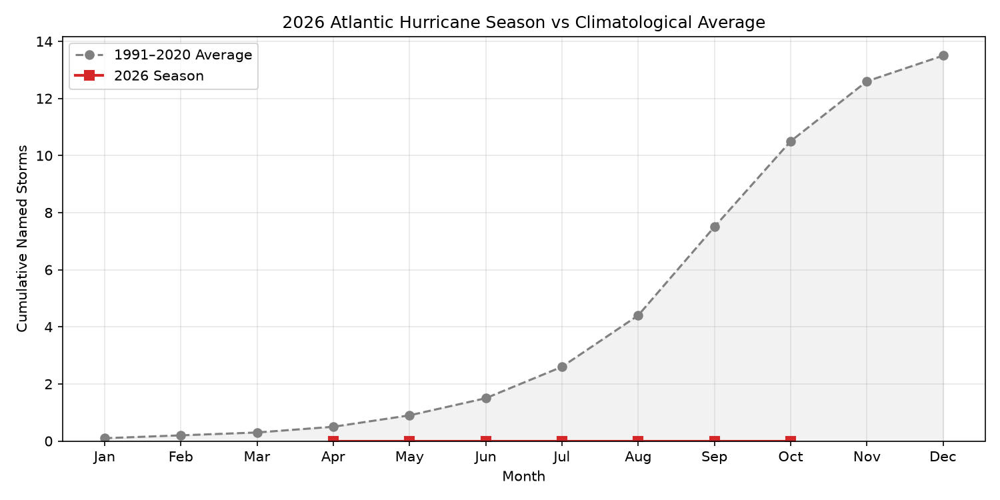

# 🌀 Atlantic Hurricane Season Tracker

*Last updated: 2026-10-22 12:42 UTC*

---

## Active Tropical Systems

### Summary for Subtropical Storm Josephine (AT5/AL102026)

- **Max sustained winds:** see advisory mph
- **Movement:** ...JOSEPHINE ACCELERATING NORTHEASTWARD AWAY FROM THE UNITED STATES... ...EXPECTED TO BECOME A POWERFUL EXTRATROPICAL CY

### Subtropical Storm Josephine Public Advisory Number 3

- **Max sustained winds:** see advisory mph
- **Movement:** ...JOSEPHINE ACCELERATING NORTHEASTWARD AWAY FROM THE UNITED STATES... ...EXPECTED TO BECOME A POWERFUL EXTRATROPICAL CY

### Subtropical Storm Josephine Forecast Advisory Number 3

- **Max sustained winds:** see advisory mph
- **Movement:** Issued at 0900 UTC THU OCT 22 2026

### Subtropical Storm Josephine Forecast Discussion Number 3

- **Max sustained winds:** see advisory mph
- **Movement:** Issued at 500 AM AST Thu Oct 22 2026

### Subtropical Storm Josephine Wind Speed Probabilities Number 3

- **Max sustained winds:** see advisory mph
- **Movement:** Issued at 0900 UTC THU OCT 22 2026

### Subtropical Storm Josephine Graphics

- **Max sustained winds:** see advisory mph
- **Movement:**  
 <a href="https://www.nhc.noaa.gov/refresh/graphics_at5+shtml/092257.shtml?tswind120">
<img src="https://www

### Subtropical Storm Josephine 5-Day Track, Uncertainty Cone, Warnings (.shp)

- **Max sustained winds:** see advisory mph
- **Movement:** GIS Data last updated Thu, 22 Oct 2026 08:50:13 GMT

### Subtropical Storm Josephine Best Track Information (.shp)

- **Max sustained winds:** see advisory mph
- **Movement:** GIS Data last updated Thu, 22 Oct 2026 08:50:22 GMT

### Subtropical Storm Josephine Best Track Information (.kmz)

- **Max sustained winds:** see advisory mph
- **Movement:** GIS Data last updated Thu, 22 Oct 2026 08:50:20 GMT

### Subtropical Storm Josephine Forecast Information (.shp)

- **Max sustained winds:** see advisory mph
- **Movement:** GIS Data last updated Thu, 22 Oct 2026 08:50:30 GMT

### Subtropical Storm Josephine Information by ATCF XML Prototype

- **Max sustained winds:** see advisory mph
- **Movement:** Issued at Thu, 22 Oct 2026 08:46:24 GMT. This is only a prototype and the file format may change without notice.

---

## 2026 Season Statistics

| Metric | Count | Avg (1991–2020) |
|--------|------:|:---------------:|
| Named Storms | **0** | 14.4 |
| Hurricanes | **0** | 7.2 |
| Major Hurricanes (Cat 3+) | **0** | 3.2 |

---

## Sea Surface Temperature — Main Development Region

**Current SST anomaly (MDR, 10°N–20°N / 20°W–60°W):** +1.14 °C

---

## Season Progress Chart

---

## Data Sources

- [NOAA National Hurricane Center](https://www.nhc.noaa.gov/)
- [NOAA CPC SST Indices](https://www.cpc.ncep.noaa.gov/data/indices/)
- Climatological averages: NOAA/NHC 1991–2020 base period
